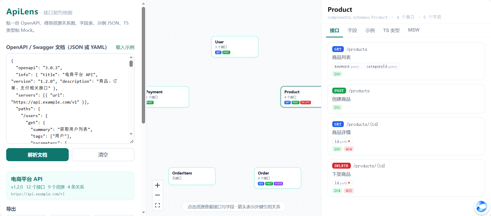

# ApiAtlas · 接口契约地图

贴一份 OpenAPI / Swagger 文档，立刻得到**资源关系图、接口清单、字段表、示例 JSON、TypeScript 类型和 MSW Mock**——前后端联调的“看不懂接口”问题，一次解决。

> 核心能力全部**确定性解析**，不调用任何 AI，所以结果稳定、不怕模型幻觉；AI 只是可选的“帮每个接口写一句人话说明”。

## 特性

- 🗺️ **资源关系图**：自动识别 `components.schemas` 里的资源，从 `userId` / `$ref` 推断外键关系，生成可点击的依赖图
- 📋 **接口清单**：按资源分组展示方法、路径、参数、错误码，一眼看清“这个资源有哪些操作”
- 🧾 **字段表**：字段名、类型、是否必填、中文说明
- 🧪 **示例 JSON**：根据 schema 递归生成真实感示例（尊重 `example` / `enum` / `format`）
- 🅣 **TS 类型生成**：一键导出 `api-types.ts`，`$ref` 自动映射为接口名
- 🎭 **MSW Mock 生成**：一键导出 `mocks.ts`，直接扔进项目就能联调
- 🤖 **AI 补充说明（可选）**：为每个接口生成“谁在什么场景调用、产生什么结果”，支持任意 OpenAI 兼容接口
- 📄 **支持 JSON / YAML**，OpenAPI 3.x

## 快速开始

```bash
npm install
npm run dev
```

打开 http://localhost:5174 ，点「载入示例」即可看到电商 API 的完整效果，或粘贴你自己的文档。



## 典型用法

**前后端联调前**：把后端给的 OpenAPI 文档贴进来 → 看资源关系图确认数据模型 → 导出 `api-types.ts` 和 `mocks.ts` → 前端在后端接口就绪前就能开发和联调。

**接手老项目**：贴一份 spec，快速搞清“订单和支付怎么关联的”“这个资源有哪些接口、返回什么错误码”。

**写文档**：导出 TS 类型和示例 JSON，直接放进 README 或接口文档。

## 支持的输入

- OpenAPI 3.0 / 3.1（JSON 或 YAML）
- Swagger 2.0 建议先转换为 3.x（可用 `swagger2openapi`）
- 资源识别规则：`components.schemas` 中带 `properties` 的对象；关系识别规则：`xxxId` 字段与 `$ref`

## 部署

**GitHub Pages**（纯静态，AI 说明功能需支持浏览器直连的服务商）：

推送到 `main` 后，在仓库 Settings → Pages → Source 选择 **GitHub Actions**，之后自动部署。

**Vercel**（推荐，支持智谱等需要代理的服务商）：

导入仓库 → Framework Preset 自动识别 Vite → Deploy。`api/proxy.js` 会自动成为代理接口。

## 技术栈

Vite + React 18 + TypeScript · [@xyflow/react](https://xyflow.com/) 关系图 · 自研 OpenAPI 解析 / Mock / TS / MSW 生成器（零 AI 依赖）· 原生 fetch 调用 OpenAI 兼容接口

## Roadmap

- [ ] 支持从 URL 拉取 spec（并支持私有文档的 token）
- [ ] 接口变更对比（两个版本 spec diff，高亮新增/删除/字段变更）
- [ ] 生成前端请求代码（fetch / axios / TanStack Query hooks）
- [ ] OpenAPI → 表单/表格页面脚手架
- [ ] 校验：spec 与真实响应不一致时告警
- [ ] Swagger 2.0 原生支持

## License

MIT
